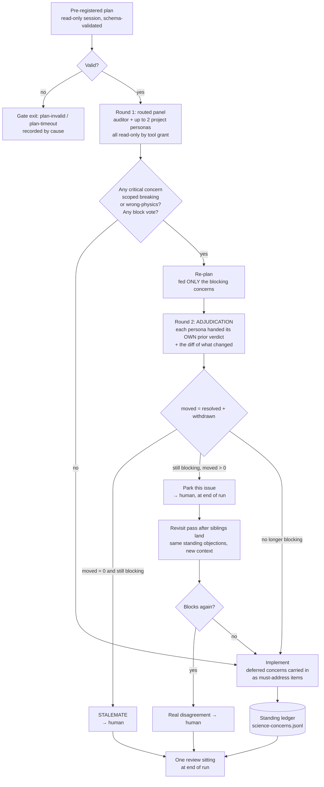

# The human in the loop, when the decision matters

*A technical account of where a person enters this pipeline, why exactly there, what the
machine owes them when it calls, and what it is forbidden from calling them about.*

Companion to [`gaia-automation.md`](gaia-automation.md), which describes the pipeline
itself. This document is about one property of it: the placement of the human.

---

## 1. The problem, stated precisely

Ground rule 2 of the Gaia charter says:

> **Human gates.** Stop for a human on anything consequential, irreversible, or
> outward-facing. Orchestrate up to that line and stop.

That is the right rule and it is unimplementable as written, because *consequential* is
exactly the judgment we are trying to automate. Every autonomous research pipeline
degenerates toward one of two failures, and both of them are failures of this rule's
mechanisation, not of its intent:

**Failure A — the pager.** The gate fires on every deep review. A human is interrupted
per contested plan, arrives with no context, re-derives a distinction the reviewers had
already made implicitly, and learns within a week that the escalations are mostly noise.
The rational response to a noisy pager is to stop reading it, at which point the gate has
negative value: it costs interruptions *and* it no longer stops anything, because it is
being rubber-stamped.

**Failure B — the rubber stamp.** The gate fires on nothing, or on something a determined
agent can talk its way past. Work proceeds; a sign error in a unit convention propagates
into six downstream issues; the cost surfaces a month later as rework of everything built
on top.

The two failures are not symmetric, and their asymmetry is the whole design. A false page
costs one context switch — minutes to hours, plus the corrosion of trust. A missed
`breaking` finding costs the rework of every artifact built on the wrong interface, and
it is discovered late, by someone who did not make the error. So the gate must be
**cheap to be wrong toward stopping** and **expensive to be wrong toward proceeding**,
while still keeping the total page rate low enough that a human reads every page.

That trilemma is what the rest of this document resolves. The resolution has one central
move, and it is worth stating before the machinery:

> **Severity is a property of the finding. Scope is a property of the consequence.
> Only consequence justifies an interruption.**

---

## 2. What actually happened: issue #186

The design below is not hypothetical. It is the direct product of the science gate's first
completed run, and every mechanism can be traced to something that run got wrong.

On 2026-08-20 the gate ran end to end on issue #186 (*"P0: Back-transform Stage-3 kriging
predictive variance before combining uncertainty"*). A read-only `gaia-study-designer`
session pre-registered a plan; three read-only personas reviewed it before a line of code
was written. The artifacts are on disk in `.gaia-runs/plan-186-20260820T213824Z/` — gitignored, so
they live on the machine that ran it, not in the repository.

| | |
|---|---|
| Personas | `gaia-auditor`, `twin-hydrogeologist`, `twin-geostatistician` |
| Verdicts | `revise`, `revise`, `revise` — **nobody voted `block`** |
| Concerns | **41** total: 12 `critical`, 19 `major`, 10 `minor` |
| Per persona | auditor 4/8/2 · hydrogeologist 2/3/2 · geostatistician 6/8/6 |
| Aggregate decision | **`block`** — the batch stopped |
| Planning session | $2.44, 630 s, 2 turns (`.gaia-runs/records.jsonl`) |

The aggregation rule at the time was *"any `block` vote, or any `critical` concern"*. No
one voted block. Twelve criticals were enough. The batch stopped, and a human was called
mid-run.

**The panel was right and the decision was useless.** Reading the concerns afterwards,
they are not interchangeable:

- `twin-hydrogeologist`: `interpolate_residuals.py` adds a water-table **elevation**
  anomaly to a **depth** baseline, violating the project's own invariant
  `ΔD = −Δh_wt` — the product's seasonal signal is sign-inverted. That is not a
  refinement. Everything downstream that reads seasonal high water table is wrong.
- `twin-geostatistician`: `QuantileTransformer` clips normal scores at ±5.199, so at
  `MIN_SITES_PER_MONTH=30` two of thirty points carry `z² = 27` and `Var(z) ≈ 2.7`
  instead of 1 — every variogram pair involving them inflated ~50×. Also not a
  refinement.
- `twin-geostatistician`: two producers **outside** the declared 13-file scope
  (`interpolate_baseline.py`, `interpolate_anomalies.py`) already write the same artifact
  names, so after the fix one filename can hold either NST-space or metre-space sigma.
  An interface question — it reaches other issues.
- `twin-geostatistician`: Clopper–Pearson assumes independent Bernoulli trials, but
  withheld wells are spatially correlated at the variogram range, so the coverage
  interval is too narrow and the n=316 power threshold is optimistic. **Real science,
  entirely inside this milestone's own deliverable.**
- `gaia-auditor`: `σ_response = sqrt(1−R²)·5.0` has no hydrogeologic provenance and is
  inverted with respect to domain. Real, and again inside the milestone.

The first three are decisions someone has to make before the work proceeds. The last two
are work items. The gate could not tell them apart, so it escalated all of them, and
called a human to perform a triage the reviewers had already performed implicitly — they
simply had nowhere to write it down.

**The lever is not to ask the panel to find less.** Review depth is the asset. The
geostatistician's observation that kriging weights are invariant to a variogram scale
factor (so `ẑ` must *not* be rescaled, only `σ_z²`) is a bug that would otherwise have
shipped, and it was raised as `minor`. What was miscalibrated is not the finding rate.
It is what a finding *triggers*.

> **Caveat, stated because it matters for how much weight this evidence carries:** the
> `scope` field did not exist when #186 ran. The verdicts on disk carry
> `severity`, `claim` and `decisive_test` only. The re-classification above is a reading
> of those concerns, not a measurement of the new field in action. The design claim —
> that reviewers can and will declare scope reliably — is at this writing **unmeasured on
> a real run**. See §11.

---

## 3. The taxonomy of handoffs

Every point at which this pipeline can hand control to a person, classified by *why*.
The last column is the one most such tables omit and the one that matters most: **what
happens if the human never arrives.**

### Class A — reserved by policy (never automated, regardless of evidence)

These do not depend on a model's judgment at all. They are consequential, irreversible or
outward-facing by their nature, which is ground rule 2 applied directly.

| Decision | Mechanism | Default with no human |
|---|---|---|
| Closing an epic / tracking issue | Pipeline comments, never closes | Stays open indefinitely — correct |
| Which of two colliding designs the project adopts | Arbitration verdict posted as **advisory** on both PRs; blocked side held | Both PRs stay open, labelled `needs-human-decision` |
| Fate of a parked branch (resume / rewrite / drop) | `gaia/parked/*`, nothing prunes | Branch persists; nothing is lost |
| Manuscript submission, data/code release, field commitment, large allocation | Out of pipeline scope entirely | Never happens autonomously |

The collision case deserves emphasis, because it looks more authoritative than it is. A
verdict of `A` means *"land A first"*. It does **not** mean *"the project has chosen
design A"*. The pair is whatever two branches happened to touch the same files, usually
resolving *different* issues; it is not an A/B bake-off. The mechanism exists to make a
collision visible and stop a silent double-merge — not to settle architecture.

### Class B — escalations on evidence (the machine decided this needs a person)

| Trigger | Where | What the human decides | Default with no human |
|---|---|---|---|
| `critical` concern scoped `breaking` or `wrong-physics` | `gaia_panel.py::aggregate` | Whether the objection stands, and what the plan becomes | Issue parked, labelled, batch continues |
| **Stalemate** — a round that resolved and withdrew *nothing* while still blocking | `gaia_panel.py::aggregate` | Whether the panel or the plan is wrong | Parked; no further planning spend |
| Second block after the revisit pass | `gaia_run_queue.sh` | A real disagreement, with siblings' landed work as context | Parked |
| Three strikes on an identical failure signature | `gaia_failsig.py` | Whether the approach is viable at all | Run stops iterating |
| Auditor blocks a PR, or returns an unparseable verdict | `gaia_run_queue.sh` | Merge or not | PR left **open**, never force-merged |
| Gate-integrity violation (test skipped, tolerance raised, gate definition altered) | `gaia_gate_integrity.py` | Whether the weakening is legitimate | Blocked |
| Persona dispatch missing from the transcript | `gaia_panel.py --expect-for` | — (fails closed to `block`) | Blocked |
| Plan invalid, or planning timed out | `gaia_plan.py --from-stream` | Whether to re-plan | Gate exit recorded by cause |
| Checks red, DOI check fails, quarto render fails, Copilot review times out | `gaia_run_queue.sh` | — | PR left open with a log |

Every Class-B path shares one property: **it leaves the work recoverable and the record
complete.** Nothing is force-merged, retried silently, or discarded. A parked branch is
pushed before it is renamed, so the work survives loss of the machine.

### Class C — explicitly *not* a page

This class is the design's actual contribution, and it is defined by exclusion: findings
that are real, correct, worth acting on, and nevertheless must not interrupt anyone.

| What | Where it goes instead |
|---|---|
| `critical` or `major` scoped `in-milestone` | Posted on the issue · recorded in `panel.json` · **carried into the implementation prompt as a must-address item** · appended to the standing ledger |
| Any `minor` concern | Ledger and issue record |
| Net loss of tests or assertions in a diff | Reported as a **warning**, never a block — a genuine refactor produces it too |
| A wrong grouping in the standing-concern digest | Costs a glance, not a decision — nothing gates on it |

**Deferred is not discarded, and the panel prompt says so.** This is not politeness; it
is incentive design. A reviewer who believes a finding will be dropped learns to inflate
its scope until it is heard, and scope inflation is the one failure mode that would
collapse this whole scheme back into Failure A.

---

## 4. The decision flow



---

## 5. Scope: the field that makes the gate a gate

Every concern declares a **scope** alongside its severity.

| Scope | Meaning | Blocks? |
|---|---|---|
| `breaking` | Fixes an interface, artifact name, unit convention or assumption that **other** issues will build on. Wrong here forces rework elsewhere later | yes, at `critical` |
| `wrong-physics` | The result would be physically or mathematically **incorrect as stated** — not merely under-validated or short of the ideal method | yes, at `critical` |
| `in-milestone` | Real, but its correction lives inside this issue's deliverable or a follow-up that can be filed and scheduled | no |

Configured by `GAIA_PANEL_BLOCK_ON` (default `breaking,wrong-physics`). Three properties
of that configuration are deliberate:

1. **An unrecognised value falls back to the default**, rather than opening the gate.
2. **There is no way to block on nothing.** Running without a science gate is
   `GAIA_SCIENCE_GATE=0`, which is printed in the run banner. Disabling review is
   allowed; disabling review *while appearing to review* is not.
3. **An undeclared or unrecognised scope blocks.** A persona whose prompt has not been
   updated behaves exactly like the old gate rather than slipping past it.

Symmetry matters on the way back, too: only the **blocking** concerns are fed to the
re-plan. Handing a planner all forty-one is not a redirection — it is scope creep with a
review as its excuse.

`scripts/gaia-launch/tests/test_panel_scope.py` pins the rule in both directions,
including every fail-closed path.

---

## 6. Convergence as a number, not an impression

The question *"should a human be called yet?"* is usually answered by a round counter —
try twice, then escalate. A counter is a poor instrument: two productive rounds and two
rounds of noise look identical to it.

The revision loop could not converge at all, for a structural reason. Every panel call is
a fresh `claude -p` session with no memory of the last one, **and every round overwrote
the previous round's verdicts on disk**, so there was nothing to remember it with. A
persona reviewing a revised plan re-derived from whatever was in front of it: free to
resolve nothing, drop what it said last time, and object to something else instead.
Rounds differed without getting closer, and the revision budget bought noise.

So each round writes into its own `r<N>/` directory, and from round 2 each persona is
handed **its own previous verdict** — not the panel's; another persona's concerns are not
its to resolve or inherit — together with the **unified diff of what the planner
changed**. It must rule on each prior concern before raising anything new:

| Status | Meaning |
|---|---|
| `resolved` | The revision answers it |
| `unresolved` | It still stands — and the claim says what is *still* wrong, not what was |
| `withdrawn` | The reviewer no longer believes it |

`withdrawn` is load-bearing and was added on purpose. **A panel that can never back down
converges by attrition, which is not convergence.** Without it, the only way a
disagreement ends is the planner capitulating, and the escalation signal degrades into a
measure of planner stamina.

New concerns are admissible only if the *changes* introduced them, or if they are a
critical breaking / wrong-physics problem genuinely missed. Hunting for fresh objections
in parts of the plan that did not change costs another full planning cycle and settles
nothing.

That turns the escalation trigger into arithmetic:

```python
moved     = adjudicated["resolved"] + adjudicated["withdrawn"]
stalemate = bool(priors) and moved == 0 and decision == "block"
```

A round that moves nothing while still blocking is a **stalemate**: the plan and the
panel are talking past each other, and the next round is the same conversation at the
same price. The queue stops there and hands over — the same reasoning as three-strikes on
identical failure signatures. **An unrecognised status counts as `unresolved`**, so
malformed output cannot claim a concern was answered.

The revisit pass inherits this. An issue parked in pass 1 and re-planned after its
siblings landed points at the last completed round of that first pass, so it answers the
same standing objections rather than meeting a new panel. **A fresh panel has nothing to
converge on** — which is also why "just ask again with a different reviewer" is not a
convergence strategy.

---

## 7. What the machine owes the human at the handoff

An escalation is a request for a **decision**, not a request for an investigation. If the
person has to reconstruct the situation before they can rule on it, the interruption cost
is the reconstruction, and it is many times the reading cost. So every page arrives with
a complete packet:

1. **The pre-registered plan** — obstruction, ordered testable questions, approach,
   artifacts, declared budget in files/lines/runtime, stopping conditions, what would
   count as a reproducible negative result, what is explicitly out of scope. Written
   *before* the code existed, so it is a statement of intent, not a rationalisation of a
   diff.
2. **Every verdict, verbatim, on the issue** — posted at the moment it could still have
   changed the approach.
3. **A decisive test per concern.** This is a hard requirement of the panel contract:
   *a concern with no test that would settle it is an opinion, and opinions do not block
   work.* The practical consequence for the human is large — the page does not say "the
   NST looks wrong", it says *fit `QuantileTransformer` on n ∈ {30,100,500,800} iid
   N(0,1) draws and print `z.var()`; compare recovered sill/range/nugget against
   van-der-Waerden scores.* The person is handed the experiment that ends the argument.
4. **The chair's summary** (§8).
5. **The diff**, for round 2+.
6. **The parked branch**, pushed before renaming, plus `needs-human-decision` on the
   issue.
7. **The transcript** (`.gaia-runs/issue-<n>-<ts>.raw.jsonl`), which is the only record
   that survives a working tree being reset.

---

## 8. The chair: a reporter, not a judge

Individual verdicts are what the gate acts on. They are not what a scientist reads. Three
reviewers filing forty-one separately-scoped concerns is a database, and the questions a
person actually arrives with — *do they agree? where do they conflict? what has to happen
next?* — are answerable only by reading all of it and holding it in your head.

So the panel also summarises, and the division of labour inside that summary is the
integrity property:

**Mechanical — computed, and cannot be fabricated.**
`convergence()` reports where *different* reviewers landed on the same thing. Two
personas from different disciplines independently naming the same file, symbol or method
is the strongest signal a panel produces: corroboration no single reviewer can
manufacture. It is keyed on **referents**, not wording, and rarity-weighted — sharing
`interpolate_residuals.py` when six concerns mention it is not agreement, it is working
in the same area. Reported naively that produced nineteen "agreements" on a panel that
had perhaps four. The critical-issue list is taken straight from the aggregate the gate
itself used, so the summary cannot describe a decision other than the one made.

**Judged — written by a chair.**
What the disagreements actually *are*, and what the panel proposes doing about them. No
mechanical rule reads scientific conflict out of prose.

The chair is dispatched as the **lab-notebook** persona — the documenter — precisely
because it has no scientific stake to add. It is called **after** `decision`,
`blocking_concerns` and `stalemate` are already fixed, and it cannot change them.

Which gives the fail-closed rule its one principled exception:

> **Fail closed on anything that gates. Fail soft on anything that only describes.**

A missing persona dispatch, an undeclared scope, an unparseable auditor verdict, an
unrecognised prior status — all block. A synthesis that fails to parse costs the prose
sections and nothing else. It *must* fail soft: it is a report about a decision that has
already been made, and failing it closed would let a formatting error stop science.

---

## 9. Verifying that the reviewer was real

A human's willingness to act on an escalation depends on the reviewer's identity being a
fact rather than a claim. "Use the gaia-auditor agent" is prose. Whether the session
actually *delegated* — and therefore whether that persona's system prompt, tool grant and
model tier were ever loaded — is a fact recorded in the transcript as a `Task` dispatch
carrying a `subagent_type`.

Real queue runs do dispatch (issue #154's run dispatched seven), but the count varies,
and **a verdict from a session that never dispatched is the base model in costume**: the
persona's name, none of its charter. So each panel call runs with
`--output-format stream-json` and the transcript is checked for the expected
`subagent_type`. A missing dispatch fails closed to a block. Project personas resolve as
a bare name and plugin personas as `gaia:<name>`; `gaia_panel.py --expect-for` owns that
mapping so it lives in one place.

Preflight refuses to start if the gaia plugin is not installed, or if any project persona
file is missing. Both failures degrade the judges silently while still returning
confident verdicts — which is worse than a batch that refuses to begin.

The reviewers themselves are **specific to this twin** (`.claude/agents/twin-*.md`),
derived from this repository's own review record and carrying its ranked concerns as
priors. A generic reviewer does not know that an 18.5 m baseline RMSE cannot serve a
sub-metre liquefaction requirement, or that `ΔD = −Δh_wt` makes two prior entries an
error. Routing is by the issue's own labels and milestone, capped at three to bound cost,
and **the auditor sits on every panel** — ground rule 1, the maker is never the sole
judge.

---

## 10. The concerns that don't stop work, and are then forgotten

This is the expensive failure, and it is the mirror image of the pager problem.

A deferred concern used to be posted on its issue, handed to the implementer, and then
gone at the end of the run. The panel's real science evaporated every time, and the next
issue over the same ground rediscovered it from scratch — at full price, with a fresh
panel, arriving at the same conclusion.

So deferred concerns accumulate in `.gaia-runs/science-concerns.jsonl`, and are read
**holistically**. `gaia_concerns.py --render` groups them by the code, symbols and named
methods they point at rather than by wording, because reviewers from different
disciplines describe one problem in completely different words. On the real #186 panel
that turns **31 objections into seven groups** — the largest being six concerns from two
personas that are all one problem: the out-of-fold coverage validation is broken
(overlapping CV folds, a Clopper–Pearson interval that assumes independence, and a
quadrature that assumes independent error terms).

Two implementation notes carry the epistemics:

- **Prose similarity was tried first and rejected on measurement.** The best true pair
  (two personas independently on Clopper–Pearson) scored *below* a false one, and
  boilerplate like "stopping condition" manufactured matches between unrelated concerns.
  Two concerns are related when they are about the same thing, not when they use the same
  words.
- **The weight is `1/(df−1)` per shared referent, not textbook IDF**, so a pair's score
  does not drift as unrelated issues are added later. A record whose grouping changes
  because the ledger grew is not one anyone can trust.

It is a reading aid: nothing gates on it, and each group states what its members have in
common, so a wrong grouping costs a glance rather than a decision.

The digest prints **once, at the end of a run**, next to the parked list and explicitly
separate from it. That separation is the thesis of this document in one line:

> **Parked issues are decisions to make now. Standing concerns are a document to read in
> one sitting.**

---

## 11. Batching: one sitting, not one interruption per plan

A science-gate block used to set `batch_failed` and `break`, so one contested plan
discarded its siblings' work and stopped the run. Issues share a batch because they share
a **milestone**, not because they depend on each other — so that multiplied one
disagreement into an idle run and a human called mid-batch.

Now a block parks one issue and the batch carries on. Two consequences follow, both about
what the human can trust when they finally look:

- **Closure is driven by what landed, not by the batch.** `Closes #N` lines are rebuilt
  from the issues that actually committed, on every landing, and any closing keyword the
  lab-notebook writes for a parked issue is stripped from the PR body before merge. An
  issue we cannot prove was resolved stays open.
- **Parked issues get one revisit pass** at the end of the batch, with everything their
  siblings just landed as context (`GAIA_REVISIT_PARKED=1`). This is not a retry of the
  same prompt: the code and the record have changed since the panel blocked, and on the
  first pass that context did not exist *at any price*. A second block is a real
  disagreement and belongs with a human.

Every park is collected into `.gaia-runs/parked-<run>.md` and printed once, at the end of
the run.

And a quieter fix that exists purely to make this loop measurable: a batch that died at
the gate used to record **nothing**, because `write_measurement` is only reached at commit
time. The corpus meant to answer *"does reviewing plans change outcomes?"* could not see
the runs where the gate acted. Gate exits now write a record keyed by cause —
`plan-timeout`, `plan-invalid`, `panel-block`, `panel-stalemate`.

---

## 12. What this does not solve

Stated plainly, because a document about honest escalation that oversells its own
mechanism would be self-refuting.

1. **Round 2 has never run on real data.** The adjudication protocol, the `moved` count
   and the stalemate rule are pinned by 90 tests in
   `scripts/gaia-launch/tests/`, and are untested against a live panel. #186 blocked in
   round 1 under the old rule. The convergence numbers in §6 are a design, not a result.
2. **Scope is self-declared, and the anti-inflation measures are unmeasured.** Deferred
   concerns are published, recorded and carried into the implementation prompt precisely
   so that scope is not the only route to being heard. Whether that holds — whether the
   observed `breaking`/`wrong-physics` rate stays near the ~3-of-12 the #186 concerns
   suggest, or drifts upward as personas learn what stops work — needs a corpus of runs
   that does not exist yet.
3. **The stalemate rule is gameable.** One trivial `withdrawn` manufactures `moved > 0`
   and buys another round. Nothing currently detects a withdrawal that is not a real
   change of mind.
4. **Nothing enforces the sitting.** The standing ledger is printed once and can be
   ignored forever. Its value is entirely contingent on a human habit the pipeline cannot
   create.
5. **The human is the slowest component, and parked work ages.** A parked issue whose
   siblings keep landing gets progressively harder to resume; nothing currently measures
   or bounds that staleness.
6. **The counterfactual is unmeasured.** The corpus of gate-exit records now exists, and
   at this writing contains **one row**. Whether reviewing plans changes outcomes is an
   open empirical question in this project, not a settled one.
7. **A model's `critical` is not calibrated against a human's.** Twelve criticals on one
   issue's plan is prima facie evidence of that. Scope routes around the miscalibration
   rather than fixing it.

---

## 13. The principles, distilled

Portable to any pipeline with autonomous reviewers and a scarce human.

1. **Separate how-wrong from how-far.** Severity belongs to the finding; scope belongs to
   the consequence. Escalate on scope. Record severity.
2. **Only consequence justifies an interruption.** A correct, important finding whose
   correction fits inside the current deliverable is work, not a decision.
3. **Deferred must not mean discarded — and the reviewer must be told so.** Otherwise the
   reviewer inflates scope, and the gate reverts to a pager.
4. **Demand a decisive test.** A concern with no test that would settle it is an opinion.
   Opinions do not block work, and the test is what turns a page into a decision.
5. **Make convergence a number.** Escalate when the loop demonstrably stops moving, not
   after N rounds by fiat. Give reviewers a way to back down, or convergence becomes
   attrition.
6. **Fail closed on anything that gates; fail soft on anything that only describes.**
7. **Verify the reviewer's identity, don't assume it.** A judge that was never loaded is
   the base model in costume.
8. **Never let one contested decision discard unrelated work**, and never close what you
   cannot prove was resolved.
9. **Batch by decision-urgency.** One review sitting beats one interruption per finding,
   and things needing a decision *now* must be printed separately from things needing to
   be read.
10. **Instrument every exit path**, including the ones where the gate acted — otherwise
    the pipeline cannot tell you whether any of this works.

---

*Cross-references:*
[`gaia-automation.md` §The science gate](gaia-automation.md) ·
[`gaia_panel.py`](../scripts/gaia-launch/gaia_panel.py) ·
[`gaia_concerns.py`](../scripts/gaia-launch/gaia_concerns.py) ·
[`gaia_run_queue.sh`](../scripts/gaia_run_queue.sh) ·
[`postmortem/2026-08-18-gaia-run.md`](postmortem/2026-08-18-gaia-run.md)
