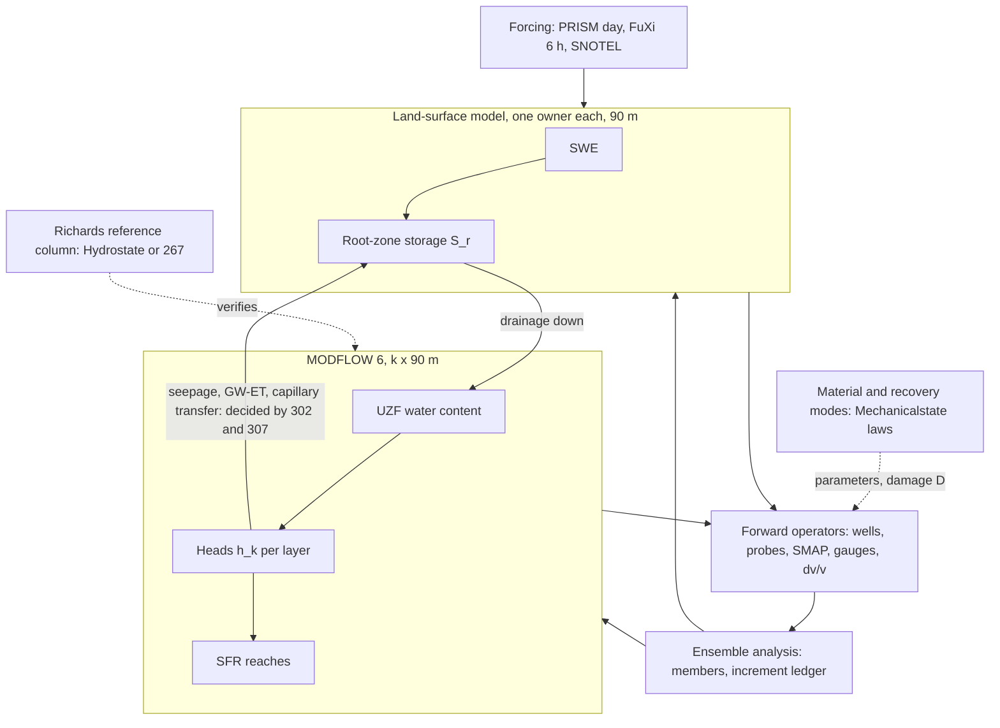

# Adversarial review of the GAIA soil-state proposal, delivered as a tracked validation ladder

Review date 2026-11-07 to 2026-11-09. Reviewer: Claude (Fable 5.1), on request of the PI, read-only
with respect to all model code. Epic: #296. Log: [`TRACKER.md`](TRACKER.md) (regenerated by
`python scripts/review_tracker.py`). Issue bodies and amendments: [`issues/`](issues/). Executed
evidence: [`results/`](results/) written by [`scripts/`](scripts/).

Revisions inspected (verified with `git rev-parse`, `git diff --stat`, `gh api`):

| Repository | Reviewed revision | Current main (2026-11-09) | `src/` + `tests/` changed since |
|---|---|---|---|
| gaia-hazlab/gwl-space-time-smooth ("the twin") | `435445f` | `435445f` | no |
| gaia-hazlab/hydrostate | `c9328f3` | `e7e6f45` | no (docs and scripts only) |
| gaia-hazlab/mechanicalstate | `b86d3b2` | `8e1b0b4` | no (docs only) |

Decision status: issue #265 records the PI direction of 2026-10-18 (MODFLOW 6 GWF+UZF+SFR below
the root zone, watershed models, water table and soil moisture in the state, assimilation of raw,
proxy and satellite data) and still carries `needs-human-decision`. Partition option B, the
depth-to-water rule inside the root zone, "UZF advanced but not updated", k x 90 m cells,
hydrostratigraphic layering, the localization taper and the heads-prognostic contract are
proposals, each with a test below. PRs #272 and #273 are open and unmerged. Hydrostate's
`docs/soil_state_architecture.md` (the proposal under review) predates that direction.

## 1. Verdict

The proposed allocation can become the binding soil-state framework only under four
restrictions. (1) The twin is the host for observations, footprint operators, priors, diagnostics,
grid and data plumbing; its store-model groundwater and its forecast engine are not reused as the
state, because the store model creates water through an undebited capillary term, has no sink in
valley cells, and the forecast reinitialises on every call (findings 1 to 4, all executed). (2)
The groundwater core is MODFLOW 6 as the PI directed; the root-zone/MODFLOW interface is decided
by the option A versus B column experiment (#302) before #280 implements it, because #280 as
written books every upward flux as evapotranspiration and can never replenish the root zone from
below (finding 8). (3) Hydrostate's Richards kernel is a reference column and
material-transaction library, not a selectable regional backend, until it has seepage and
free-drainage boundaries and nonlinear convergence (finding 10; decision #310). (4) Hazard
products stay static susceptibility or antecedent state until each consumer is executed and
validated on events: the Landlab component the twin names does not read the fields the twin
exports (finding 6) and the published liquefaction maps are static in depth to groundwater
(finding 7).

| Reuse | Consolidate | Replace |
|---|---|---|
| `observability.py` footprint operators, Matern prior and FFT embedding, DFS and resolution diagnostics; `hydro_state.py` vocabulary; `well_hydrostratigraphy`; data fetchers; `DOMAIN`; Hydrostate `flow.py` and `coupling.py` kernels; Mechanicalstate `petrophysics.py`, `evolution.py` | one snow model (two today), one root-zone bucket (two today), one water ledger, one dv/v operator with one set of constants | store-model groundwater (MODFLOW 6); the reinitialising forecast (state-continuing ensemble, #191, #234); raster "exports" presented as couplings (executed consumers, #300, #129); the statistical DTW product as state (prior and benchmark only, #286) |

## 2. What was executed, inspected, unavailable

| Executed (this review, pixi interpreter 3.11.15, numpy 2.4.3) | Inspected only | Unavailable |
|---|---|---|
| `scripts/l1_closed_column.py` (#297): closed-column ledger, 8 cases, ON/OFF controls, storage-bound sweep, dt comparison | twin: `water_budget.py`, `forecast.py`, `hydro_state.py`, `hysteresis.py`, `observability.py`, `dvv.py`, `dvv_coupling.py`, `landlab_export.py`, `interpolate_residuals.py`, `gwl_dynamic.py`, tests, ROADMAP, book chapters, 2026-10-18 MODFLOW plan and review | MODFLOW 6 and flopy (not installed; #275 open): option A/B column (#302) and UZF restart (#303) are specified, not run |
| `scripts/l2_reinitialisation.py` (#298): snow restart, `theta_ref`, segmented budget, hysteresis branch, centring leakage, two snow models | hydrostate: `flow.py`, `valley.py`, `coupling.py`, `observations.py`, `verification.py`, `docs/technical/*`, CI runs | field data: no observational run was repeated; D7 calibration numbers are read from ROADMAP and `calibrate_fluxes.py` |
| `scripts/u1_dependence_sensitivity.py` (#299): 18 prior/noise configurations, 10 000 draws each, cross-checked against `matern_correlation` (max difference 7e-16) | mechanicalstate: `petrophysics.py`, `evolution.py`, `coupling.py`, evidence JSONs, CI runs | codameter kernel observable (#247 amended; disba and codameter import, the check was not run here) |
| `scripts/p1_bounded_performance.py` (#301): 200^2 and 400^2 tiles x 365 d; 800^2 refused by preflight | Landlab `landslide_probability.py` source (master); Strauch et al. 2018; arXiv 2509.10962 v1 pp. 6-12, 29-32; MODFLOW UZF documentation (flopy, USGS TM 6-A19 summary) | Python 3.12 Gaia lane: not rebuilt here; upstream CI runs 42398168032 (hydrostate) and 42398168451 (mechanicalstate) are green on current heads |
| `scripts/c1_landlab_causal.py` (#300): Landlab 2.10.1 in a scratch venv, positive control and invariance test | 25 issue bodies, PRs #272/#273, queue parser `scripts/gaia_group_issues.py` | |
| `scripts/e4_stage3_sign.py`: 2x2 replication of the Stage-3 assembly | | |
| twin suites: `test_water_budget`, `test_forecast`, `test_hydro_state`, `test_hysteresis`, `test_landlab_export`, `test_dvv`, `test_observability`, `test_coupling`, `test_soil_moisture` (see `results/suites.txt`) | | |

## 3. Findings, ranked

Classes: **confirmed** (executed or primary source), **declared** (the repository states it),
**conditional** (consequence depends on an unexecuted test), **disproved**.

| # | Priority | Finding | Class | Evidence | Falsification | Smallest correction |
|---|---|---|---|---|---|---|
| 1 | P0 | Capillary rise is credited to root-zone storage and never debited from the aquifer; the D7 calibration ran with the term active | confirmed | `water_budget.py:217-219, 266-273`; `calibrate_fluxes.py:67-69`; #297: +0.2464 mm/d created at DTW 1.5 m (analytic 0.2464), 79.3 mm/yr; +0.7392 mm/d at 0.5 m, 188.5 mm/yr; 0 at 2.5 m; 0 with capillary off (float32 bound 3e-5 mm) | ON/OFF recalibration of D7 differing by less than the observation error would show the fit was insensitive (not run) | debit `cap_eff/1000/S_y` from `h` (local commit `1f93f15`), or retire the term with #280's replacement transfer (#232 a amended) |
| 2 | P0 | Stage-3 depth to water adds a water-table-elevation anomaly to baseline depth (sign inverted); feeds the seasonal-high Landlab export | confirmed | `interpolate_residuals.py:205-209`; `interpolate_anomalies.py:115`; `results/e4_stage3_sign.json`: +1 m rise written as 6.0 m depth, expected 4.0 m | none needed; #230 fixes it; #311 decides product withdrawal | subtract the anomaly through `hydro_state.dtw_anomaly_from_head_anomaly` |
| 3 | P0 | Forecasts reinitialise: no state argument; SWE starts at zero; hysteresis starts on the drying branch; `theta_ref` is the post-step state; well anomalies centred over the whole window | confirmed | #298: segmented snow run loses 50 of 150 mm melt; `theta_ref` 0.2918 vs analysis 0.28; segmented budget table 2.615 vs 2.592 m; hysteretic dv/v -0.135 vs -0.256 when entered mid-wetting; centring leakage -0.30 m at a 0.6 m/yr trend | #234 and #187 make the `xfail` tests pass | carry SWE, root storage, reversal state and references across calls (#234, #187, #191) |
| 4 | P0 | Stores have several owners: two snow models (thresholds 0/4/1 degC vs -1/3/0 degC), two root buckets, three groundwater products; root zone and aquifer share pore volume when DTW < root depth; cells with HAND <= wt_depth0 have no sink | confirmed | #298: 458 vs 510 mm liquid over one winter, 60 of 120 days differ; #297: valley cell reaches the surface on day 158 from 5 mm/d rain with zero baseflow | decision #309 and #282's zero-forcing test with the capillary path off and on | one owner per store (#234, #52); MODFLOW SFR/DRN replace the HAND sink (#281, #282) |
| 5 | P1 | The analysis object is mean plus marginal variance with diagonal R; no members, no issue time, no member dimension in the data plane | declared | `observability.py:140-156, 1217-1263`; `zarr_io.py:174-180` writes "1000 m", "monthly"; #299: P(min DTW over 1.8 km < 1 m) 0.17 coherent vs 0.92 independent at L 12 km, nu 1.5, R 0.1 m^2 (ratios 2 to 9 across 18 configurations); the averaged statistic moves the other way | a member-set posterior (#188 a) removes the need to sample from sigma | posterior = member set, sigma a derived export (#188, #306, #187) |
| 6 | P1 | Landlab `LandslideProbability` computes wetness from sampled recharge and ignores `water_table__depth`; the twin's manifest names it as consumer and the book says it "takes" DTW | confirmed | official source: `rel_wetness = (Re/T) a / sin(arctan(slope))`; #300: failure probability monotone in recharge mean, bit-identical under x0.5 and x2 of the exported fields; `07-hazard-integration.qmd:59-60` | none; the component's inputs are fixed | state the fork in #127: recharge-driven screening with the stock component, or the twin's FS kernel (#128) fed by h_w |
| 7 | P1 | Sanger/Geyin/Maurer products are per-cell A, B evaluated with magnitude-scaled PGA; depth to groundwater is a static Fan et al. (2013) predictor; user-supplied groundwater is future work | confirmed | arXiv 2509.10962 v1: Eq. 1 pp. 8-9, Table 1 p. 11, synthetic augmentation p. 12, future work p. 31, user implementation p. 32 | a surrogate rerun with DTW as a predictor, validated on 2001 Nisqually manifestations (#143) | #260 pins this; #270 gates; #141 wording "forecast" removed |
| 8 | P1 | #280 books every upward flux across the MODFLOW top as groundwater ET (an atmospheric sink); root-zone storage is never replenished from below; residual PET is not allocated between land-surface AET and UZF/groundwater ET | conditional | #280 body before amendment; UZF represents gravity-driven kinematic-wave flow and ET, not capillary rise (TM 6-A19; flopy UZF docs); 0.9 % of legacy baseline cells have DTW < 3 m (#297, legacy raster) | #302 zero-PET column: Richards raises root-zone water from a table 0.2 m below the root base; option B cannot unless a transfer is added | #280 amended; decision #307 |
| 9 | P1 | dv/v operator: constant 10 kPa effective stress, alpha in 1/kPa against Hydrostate's 1/m, scalar K_SAT, 0.1-4 Hz bands with kernel normalisation assumed, reference epoch 0, no thermal or damage term; depth-separated products are retrievals with their own prior | declared + conditional | `dvv_coupling.py:43-92`; `dvv.py:42, 236, 305-345, 433-435`; issues #247, #251 | #247 amended: observable, units, quadrature and a finite-difference forward check before any normalisation decision | one operator with declared kernel semantics (#198) |
| 10 | P1 | Hydrostate's 3D kernel is not mesh-converged (2x grid changes outlet volume 28.8 %; 2D toy -86 %), nonlinear MMS "not established", head/flux boundaries only, no ET, no hysteresis, checkpoint excludes snow, channel and hysteresis; Mechanicalstate uses a constant 10 kPa net stress, damages K and G while its doc says shear only, refines hydraulic and exchange steps together, and committed evidence from a dirty tree | declared + conditional | hydrostate `valley_refinement.json`, `verification.md:112-116`, `flow.py:268-269`, `coupling.py:255-256`; mechanicalstate `coupling.py:312-314`, `verify_coupling.py:25-26`, `coupling_verification.json:61-62` | hydrostate#1 column mode; mechanicalstate#1 separated sweeps | role as reference and library (#310); separated refinement (mechanicalstate#1) |

Lower priority, recorded: the only held-out score against real observations is the static
depth-to-water block-CV RMSE 18.5 m, R^2 0.09 (`05-state-evaluation.qmd:454`), against a
sub-metre seasonal-high need for liquefaction (#142); MODFLOW UZF internal memory may not be
cold-restartable (#303, decision #308); the dense `n_cell x n_obs` intermediate is 19 GB for
2.96 M cells x 863 wells and a full-domain 365-step bucket history is 113 GB if allocated (#301,
computed not allocated); no GNSS-IR operator exists (`observability.py:901-904`, `employed=False`).

Disproved during the review: a hidden shaking-to-damage or dv/v-to-hydraulic-property law in
Mechanicalstate (amplitudes and timescales are explicit inputs; `evolution.py` imports only
numpy); double assimilation of GNSS-IR (no operator to double count); the suspicion that the
storage clip at `water_budget.py:251` changes results under valid forcing (0 excursions in 73 000
cell-days; it absorbs only invalid input such as negative rain).

## 4. Hazard requirements matrix

| Application | Predicted quantity | Controlling soil variables and depth support | Extra trigger, strength, geometry inputs | Appropriate model | Scales | Observable constraints | Validation gate |
|---|---|---|---|---|---|---|---|
| Regional shallow-landslide susceptibility | annual initiation probability, relative wetness | recharge to subsurface flow; soil thickness; transmissivity | cohesion, friction, root strength, slope, contributing area | Landlab `LandslideProbability` (steady state, recharge-driven) | 10-90 m DEM; annual; no time | recharge climatology; inventory | ROC/AUC against an inventory (#224, #129); DTW does not enter |
| Storm-time shallow landslide triggering | pore pressure at the slip depth, FS(t) | transient suction and positive pressure 0.5-3 m; perched saturation on the soil/till contact | strength, slope, slip geometry, root cohesion | twin FS kernel (#128) with named pore-pressure closure, fed by a perched-layer column (#130) or Richards patch | 1-10 m hollows; hours; sub-daily forcing | piezometers, probes at depth, event timing | event hindcasts (#224) with issue-time freeze; perched-layer OSSE (#302, hydrostate#1) |
| Deep landslide, runout | displacement, runout extent | deep and fracture pressure | geology, slip surface, strength and deformation law, runout solver | site model; not this system | site | boreholes, InSAR | explicit non-claim (#127) |
| Regional liquefaction screening | manifestation index per shaking scenario | seasonal-high DTW in liquefiable units (vertical accuracy, sub-metre) | PGA_M, Vs30 class, geology | published surrogate (static in DTW) or a rerun pathway (#270) | 100 m-1 km; event | wells in unconfined lowland units; CPT sites | 2001 Nisqually manifestations (#143); #142 accuracy per HSU |
| Site liquefaction and lateral spreading | triggering FS by layer, displacement | saturation and pore-pressure profile in susceptible layers | CPT/SPT or justified Vs, shaking, free-face geometry | geotechnical analysis; LPI/LSN predict lateral spreading poorly (arXiv 2509.10962 p. 30) | point; seconds to minutes | CPT, nested piezometers | site investigation; deferred (#146) |
| River floods and inundation | routed discharge, depth, extent | runoff, interflow, baseflow source volumes and timing; channel storage | reach network, hydraulics, structures | SFR routing (#237) then a hydraulic model; `accumulate_runoff` is a weighted proxy, not routing | reach and floodplain mesh; minutes to hours | gauges, stage | volume conservation then hydrograph skill (#199) |
| Wildfire conditioning | vegetation water availability | root-zone water | fuel moisture, weather, fire model | separate fire model | daily; fuel scale | fuel sticks, RAWS | not a soil-twin claim |
| Postfire floods and debris flows | runoff and initiation from short bursts | infiltration capacity of either sign change, repellency, roughness | 5-30 min rainfall intensity, erodibility | Green-Ampt with observed or radar bursts (#132) | minutes; burn scar | radar, rain gauges at high rate | burst-intensity validation; daily inputs cannot supply it |

Sub-stepping a daily or six-hourly input cannot recover burst intensity that the input never
contained; storm-time and postfire products need sub-hourly observed or radar forcing or a
disaggregation model with its own validation.

## 5. Observability and non-uniqueness

| Ambiguity | Observationally similar states | Different hazard outcome | What resolves it | What remains unknowable |
|---|---|---|---|---|
| Perched versus regional water | shallow probe reads saturation; a deep screened well reads the regional head | perched pressure on a till contact triggers a shallow slide while the regional table is metres down | a piezometer or nested wells across the cap (#130); perched layer as an MF6 layer; fall-response timing | perched extent between instruments; sub-cell convergence in hollows |
| Confined head versus phreatic surface | a well screened in a confined unit shows a head near the surface | liquefaction needs the shallow unconfined table, not the confined head | screen depth and aquifer identity (`well_hydrostratigraphy`, #9); layer-aware operator | wells without construction records |
| Moisture-driven versus damage-driven dv/v | both lower velocity after a storm that follows an earthquake | moisture recovers in days; damage recovers over months to years (Illien et al. 2022, 2025) | independent water observations (probes, wells) plus a damage state with its own timescale (#190, Mechanicalstate recovery modes); the twin has no damage term today | damage amplitude without an independent strength or displacement observation |
| Temperature versus water in dv/v | seasonal thermoelastic and hydrologic cycles share phase | a thermal signal mistaken for drying or wetting | an explicit thermal term or AR(1) bias state (#198); the twin's `run_workflow` is not implemented | deep thermal diffusion where no temperature record exists |
| Equilibrium retention versus hysteresis versus rate dependence | the same theta on wetting and drying branches; the same theta at different dS/dt | suction, stiffness and infiltration differ at equal theta | the trajectory (reversal memory carried in the state, #176); rate from sub-daily probes | the branch of a cell whose history predates the record |

Audit items. Seismic kernels: `forward_banded_dvv` assumes area-normalised kernels; issue #247
reports band sums 0.46, -0.16, 0.44, 0.66 and no node above 5 m (#251); the amended #247 settles
the observable before any normalisation. Reference window: the processing ensemble uses epoch 0
as reference (`dvv.py:236`); a forecast must freeze it at issue time. GNSS-IR: no operator;
reflectometry senses the top few centimetres over a footprint of order 1000 m^2 with vegetation
and snow as nuisance (Larson et al. 2008); GNSS loading is a basin-storage hypothesis below daily
noise (#226). Wells: Hydrostate's screened-well operator is a length-weighted arithmetic mean of
head; the twin's water-table operator refuses non-water-table targets. Discharge: Hydrostate
integrates boundary faces; the twin's `accumulate_runoff` is a weighted proxy; SFR reach outflow
(#237) is the operator. Shared errors: Lyne-Hollick baseflow, well medians and PRISM-trained
bias corrections carry correlated errors (#235, #192). Double assimilation: depth-separated dv/v
products (`separate_depth`) and the inverted DTW (`invert_dvv`) reuse the model baseline and a
retrieval prior; only raw bands through the forward operator enter the filter (#198).

## 6. Ownership and the minimal common state

Minimal member state, all restartable:
`x = (S_r, SWE, S_canopy, W_uz, h_k, q_SFR, b_hyst, D_m, pos_forcing, ref, theta_params, seed_id)`
where `W_uz` is UZF water content (or `W = theta + S_s max(psi, 0)` in a Richards patch),
`b_hyst` the reversal point and branch, `D_m` the recovery-mode amplitudes and schedule, `ref` the
frozen references (theta_ref, wt_ref, dv/v epoch, centring baseline). Diagnostics derived, never
assimilated: `D = z_s - h_wt`, `u(z)` from layer heads, `theta(z)`, `sigma'(z)`.

Assimilation transaction per cycle: forecast members through one forward operator per sensor at
native support; analysis increment booked per store as `dV = V(h_a) - V(h_f)` from MODFLOW's
piecewise storage function and the LSM bounds; increments above the MODFLOW top move into `S_r`
and are booked on both; a clip above a stated fraction of the increment fails the cycle (#304);
`model_closure_residual` and `delta_storage_DA` published separately; no datum used in both the
parameter loop (PEST++ IES) and the state loop (#235).

Uncertainty handoff: the member set with stable identities through forcing, water, material,
damage, lead time and hazard evaluation; marginal sigma as a convenience export only. #299 gives
the size of the error made otherwise.

## 7. Five acceptance experiments (as ladder issues)

| Experiment | Issue | Quantitative observable | Pass |
|---|---|---|---|
| Closed ledger and segmented restart through snow, wetting, drying, analysis | #297 (legacy evidence), #232 a, #234, #187 | combined residual; segmented vs continuous fields | residual within the float64 bound of the scheme; `xfail` tests in `tests/test_ledger_legacy.py` and `tests/test_forecast_restart_legacy.py` flip to pass |
| Option A versus B column against a Richards reference | #302, hydrostate#1 | D(t), store sums, psi at the root base, rejected infiltration, seepage, ET split, zero-PET upward transfer | D within 0.1 m; stores equal the column integral to closure; ET <= PET to 1e-6 mm; transfer within 25 % of the reference or declared |
| UZF restart memory and constrained update | #303, #304 | fields at stress-period boundaries; clipped volume fraction | equality within summation tolerance or declared spin-up error; no clipping in >= 95 % of synthetic cycles |
| Multi-event, issue-time-frozen forecast and calibration | #305, #195, #194, #299 | CRPS, coverage, PIT at withheld stations over >= 10 events; coherent vs independent tail probability | coverage within +-0.05 of nominal with block-bootstrap CI; "no value added" recorded when found |
| Consumer execution | #300, #129, #193; #270, #260 | component outputs vs recharge and vs exported fields; surrogate rerun vs static map | positive control monotone; invariance to exported DTW recorded; liquefaction product labelled static unless the rerun pathway validates on events |

## 8. Staged plan (batches of the ladder)

| Batch | Items | Gate |
|---|---|---|
| 0 (done 2026-11-09 for the twin; open in the prototype repos) | #297, #298, #299, #300, #301; hydrostate#1, hydrostate#2; mechanicalstate#1; amendments to 25 issues | none |
| 1 | #302 option A vs B column; #303 UZF restart | #275 MODFLOW toolchain |
| 2 | decisions #307, #308, #309, #310 | batch-1 and L2/H1 evidence; held for the PI |
| 3 | #280, #289 as amended; #282; #283 (a) | decisions |
| 4 | #188 fixture; #304; #284; #285 (`needs-compute`); #306; #286; #283 (b); #142 | filter correctness before the pilot; production calibration gates deployment |
| 5 | #305, #195, #194; #128 then #129, #193; #270 then #141 | a cycling pilot exists |
| final | #311 after #230; #312 human review | full tracker |

What may remain a regional screening approximation: the recharge-driven Landlab product (annual
susceptibility, not event triggering); static liquefaction susceptibility with seasonal-high DTW
as a sensitivity; daily antecedent state for flood routing. What must be fixed before any
operational hazard claim: the ledger (#232), one owner per store (#309), a state-continuing
ensemble forecast (#234, #191, #188), the interface decision (#302, #307), consumer execution
(#300, #129), and issue-time discipline (#305).

## 9. Issue map

New issues: #296 epic; #297 L1; #298 L2; #299 U1; #300 C1; #301 P1; #302 X1; #303 X2; #304 X3;
#305 X4; #306 B188; #307-#311 decisions Q1-Q5; #312 QF; gaia-hazlab/hydrostate#1 H1,
gaia-hazlab/hydrostate#2 H2; gaia-hazlab/mechanicalstate#1 M1. Amended (previous scope archived
under `
` in each body): #232, #280, #282, #283, #286, #142, #270, #188 (retitled),
#289, #187, #234, #52 (milestoned), #191, #230, #195, #235, #189, #247, #198, #127, #129, #193,
#260, #141, #267. Dependency edges added: #280 <- #232, #302, #307; #188 <- #289, #187 only;
#306 <- #188, #285, #9, #235. The queue parser reads these lines above the first `
`;
no cycle was introduced (checked by hand against each blocker set).

## 10. Sources

Resolved on Crossref on 2026-11-09 (title and authors matched):
Niswonger, Prudic and Regan 2006, UZF1, USGS TM 6-A19, doi:10.3133/tm6A19;
Langevin et al. 2017, MODFLOW 6 GWF, TM 6-A55, doi:10.3133/tm6A55;
Markstrom et al. 2008, GSFLOW, TM 6-D1, doi:10.3133/tm6D1;
Hughes et al. 2022, MODFLOW API, doi:10.1016/j.envsoft.2021.105257;
White et al. 2020, PEST++ v5, TM 7-C26, doi:10.3133/tm7C26;
Long et al. 2024, SE Puget Sound model, doi:10.3133/sir20245026v2;
Bakker et al. 2016, FloPy, doi:10.1111/gwat.12413;
Kollet and Maxwell 2006, ParFlow overland flow, doi:10.1016/j.advwatres.2005.08.006;
Maxwell and Miller 2005, coupled land surface and groundwater, doi:10.1175/JHM422.1;
Strauch et al. 2018, Landlab landslide probability, doi:10.5194/esurf-6-49-2018;
Zhu, Baise and Thompson 2017, geospatial liquefaction, doi:10.1785/0120160198;
Sanger, Geyin and Maurer 2025, arXiv:2509.10962 v1 (preprint, not Crossref);
Lu, Godt and Wu 2010, effective stress in unsaturated soil, doi:10.1029/2009WR008646;
Bogaard and Greco 2015, landslide hydrology, doi:10.1002/wat2.1126;
Kool and Parker 1987, hysteretic hydraulic properties, doi:10.1029/WR023i001p00105;
Hassanizadeh and Gray 1993, capillary pressure thermodynamics, doi:10.1029/93WR01495;
Illien et al. 2022, velocity recovery after Gorkha, doi:10.1029/2021JB023402;
Illien et al. 2025, predictable recovery rates, doi:10.1038/s41467-025-57151-8;
Shi et al. 2026, agroseismology, Science, doi:10.1126/science.aec0970;
Clements and Denolle 2018, groundwater from ambient noise, doi:10.1029/2018GL077706;
Larson et al. 2008, GPS receivers as a soil-moisture network, doi:10.1029/2008GL036013.
Official documentation read: Landlab `landslide_probability.py` (master) and its API page; FloPy
`ModflowGwfuzf` parameter descriptions; MODFLOW 6 readthedocs GWF-UZF input specification.
